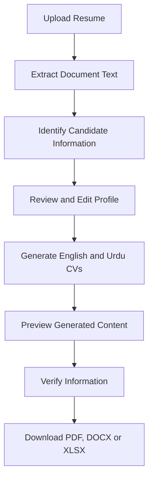

# Urdu Resume Skill Extractor
### AI-Powered Resume Intelligence & Candidate Information Extraction

<p align="center">
  <strong>Transforming Unstructured Resumes into Structured Candidate Profiles</strong>
</p>

<p align="center">
  
  
  
  
  
</p>

---

## 1. Project Overview

**Urdu Resume Skill Extractor** is an AI-assisted resume analysis and candidate information extraction web application developed using Python and Streamlit.

The system processes uploaded resumes, extracts relevant candidate information, organizes professional skills, and generates structured English and Urdu CV profiles with the assistance of Google Gemini AI.

The platform is designed to simplify resume processing, improve information organization, and provide downloadable candidate profiles in commonly used document formats.

It combines document processing, information extraction, AI-assisted content generation, and multilingual document export in one application.

## 2. Core Objectives

- Automate the extraction of candidate information from resumes.
- Organize education, experience, projects, and professional skills.
- Separate technical skills from soft skills.
- Generate professional English and Urdu CV content.
- Provide editable candidate profiles.
- Support multiple document export formats.
- Make resume processing easier through a user-friendly interface.

## 3. Key Features

### Resume Processing
- Upload PDF, DOCX, and TXT resumes.
- Extract available candidate information.
- Process contact details and professional sections.
- Organize extracted information into structured fields.

### AI-Powered CV Generation
- Generate professional English CV content.
- Generate Urdu CV content using Urdu script.
- Improve grammar, readability, and professional presentation.
- Preserve official names, technology names, and project titles.

### Candidate Information Management
- Review extracted candidate profiles.
- Edit candidate information before generating CVs.
- Separate technical and soft skills.
- Organize education, experience, projects, and languages.

### Document Export
Download generated CVs in three formats:

| Format | Purpose |
|---|---|
| PDF | Professional document sharing |
| DOCX | Editable Microsoft Word document |
| XLSX | Structured candidate information |

### Multilingual Support
- English CV generation.
- Urdu CV generation.
- Urdu right-to-left text handling in supported document outputs.

## 4. Technology Stack

| Technology | Application |
|---|---|
| Python | Core application development |
| Streamlit | Interactive web interface |
| Google Gemini API | AI-assisted CV generation |
| PDFPlumber | PDF text extraction |
| PyPDF | PDF document processing |
| Python-docx | Word document generation |
| Pandas | Data processing |
| OpenPyXL | Excel generation |
| Pillow | Image and text processing |
| ReportLab | PDF generation |
| Arabic Reshaper | Urdu text shaping |
| Python-Bidi | Bidirectional text support |

## 5. Application Workflow



## 6. Project Structure

```text
urdu-resume-skill-extractor/
│
├── app.py
├── requirements.txt
├── README.md
│
└── assets/
    └── NotoNastaliqUrdu-Regular.ttf
```

*The above shows the main application files and asset currently used for Urdu font rendering.*

## 7. Installation & Configuration

### Prerequisites

- Python 3.x
- pip package manager
- Google Gemini API key

### Step 1: Clone the Repository

```bash
git clone https://github.com/hinaarshad302/urdu-resume-skill-extractor.git
```

### Step 2: Navigate to the Project

```bash
cd urdu-resume-skill-extractor
```

### Step 3: Install Dependencies

```bash
pip install -r requirements.txt
```

### Step 4: Configure Gemini API

For local development, create:

`.streamlit/secrets.toml`

Add:

```toml
GEMINI_API_KEY = "YOUR_GEMINI_API_KEY"
```

For Streamlit Community Cloud, add `GEMINI_API_KEY` through the application's Secrets settings.

**Security:** Never commit API keys, passwords, or private credentials to the repository.

### Step 5: Launch the Application

```bash
streamlit run app.py
```

The application will open in your local browser.

## 8. Live Application

**Try the application:**

[Urdu Resume Skill Extractor – Live Demo](https://urdu-resume-skill-extractor-3vjtecyvnp6rgfuqgf7t8w.streamlit.app/)

**Source Code:**

[GitHub Repository](https://github.com/hinaarshad302/urdu-resume-skill-extractor)

## 9. Important Limitations

- Scanned PDF documents are not currently supported through OCR.
- Complex PDF columns and layouts may affect extraction quality.
- Extraction results depend on document structure and text quality.
- AI-generated content may require manual corrections.
- Urdu PDF rendering can vary depending on font and layout compatibility.

## 10. Responsible AI & Data Verification

This application provides AI-assisted information extraction and CV generation. It is not a replacement for human review.

Users should:

- Verify education, qualifications, and institutions.
- Confirm employment history and dates.
- Review skills, projects, and achievements.
- Correct inaccurate or incomplete extracted information.
- Never accept AI-generated details that are not supported by the original resume.

**The system should not invent missing candidate information.**

## 11. Future Development Roadmap

Potential future enhancements include:

- OCR integration for scanned resumes.
- Improved handling of complex PDF layouts.
- Advanced candidate search and filtering.
- Resume-job description matching.
- Enhanced Urdu document rendering.
- Additional language support.
- Advanced recruitment analytics.
- Further mobile interface improvements.

*These are planned enhancements, not claims about currently implemented functionality.*

## 12. Developer Information

**Designed & Developed by Hina Arshad**

Computer Science Graduate | AI Application Development

**Project Category:** Academic Final Year Project  
**Project Period:** 2026–2027  
**Primary Technologies:** Python, Streamlit, Google Gemini AI

GitHub: [@hinaarshad302](https://github.com/hinaarshad302)

---

<p align="center">
  <strong>Urdu Resume Skill Extractor</strong><br>
  AI-Assisted Resume Analysis & Multilingual CV Generation
</p>

<p align="center">
  Built with Python, Streamlit & Google Gemini AI.
</p>
