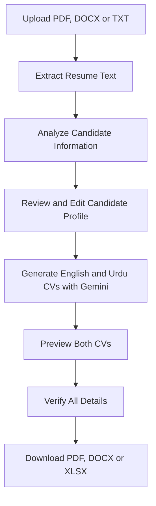

# Urdu Resume Skill Extractor
### AI-Assisted Resume Intelligence & Bilingual CV Generation

<p align="center">
  <strong>From Resume Documents to Structured Candidate Profiles</strong>
</p>

<p align="center">
  
  
  
  
  
</p>

---

## Overview

**Urdu Resume Skill Extractor** is a Python and Streamlit web application that extracts candidate information from resume documents, organizes it into an editable profile, and uses Google Gemini AI to generate separate English and Urdu CV content.

The application brings document text extraction, candidate information analysis, bilingual AI-assisted CV generation, preview, and document export into one workflow.

**Project type:** Academic Final Year Project  
**Project period:** 2026–2027  
**Developer:** Hina Arshad

## Live Demo

- **Application:** [Open Urdu Resume Skill Extractor](https://urdu-resume-skill-extractor-3vjtecyvnp6rgfuqgf7t8w.streamlit.app/)
- **Source code:** [GitHub Repository](https://github.com/hinaarshad302/urdu-resume-skill-extractor)

## Features

### Resume upload and text extraction
- Accepts PDF, DOCX, and TXT resume files.
- Extracts selectable PDF text using PDFPlumber, with PyPDF as a fallback.
- Reads text from Word and plain-text documents.
- Handles common candidate information and resume sections.

### Candidate information analysis
- Detects available contact details, including email and phone number.
- Extracts and organizes education and work experience.
- Identifies technical skills and soft skills separately.
- Detects project information and language details.
- Presents extracted information in an editable candidate profile.

### English and Urdu CV generation
- Generates separate English and Urdu CV profiles using Google Gemini.
- Provides individual English and Urdu previews.
- Keeps official names, institution names, project titles, and technology names in their original form where appropriate.
- Allows users to review and edit information before exporting.

### Document export
English and Urdu CVs have separate download options.

| Format | Output |
|---|---|
| PDF | Shareable CV document |
| DOCX | Editable Microsoft Word document |
| XLSX | Structured candidate information |

### User interface
- Streamlit-based web interface.
- Responsive styling for desktop and mobile screens.
- Separate areas for resume upload, candidate analysis, profile editing, previews, and downloads.

## Application Workflow



## Technology Stack

| Technology | Purpose |
|---|---|
| Python | Core application logic |
| Streamlit | Web application interface |
| Google Gemini API | AI-assisted CV generation |
| PDFPlumber | Primary PDF text extraction |
| PyPDF | Secondary PDF text extraction |
| python-docx | Word document reading and generation |
| Pandas | Data handling |
| OpenPyXL | Excel workbook generation |
| Pillow | Image and text rendering |
| ReportLab | PDF document generation |
| Arabic Reshaper | Urdu text shaping |
| Python-Bidi | Bidirectional text handling |

## Repository Structure

```text
urdu-resume-skill-extractor/
├── app.py
├── requirements.txt
├── README.md
└── assets/
    └── NotoNastaliqUrdu-Regular.ttf
```

The main application logic is contained in `app.py`. The Urdu font asset supports Urdu text rendering in relevant outputs.

## Setup and Installation

### Requirements

- Python 3.x
- pip
- A Google Gemini API key

### 1. Clone the repository

```bash
git clone https://github.com/hinaarshad302/urdu-resume-skill-extractor.git
cd urdu-resume-skill-extractor
```

### 2. Install dependencies

```bash
pip install -r requirements.txt
```

### 3. Configure the Gemini API key

For local development, create a file at `.streamlit/secrets.toml`:

```toml
GEMINI_API_KEY = "YOUR_GEMINI_API_KEY"
```

For Streamlit Community Cloud, add the same secret in the app's **Settings → Secrets** section.

**Security:** Keep your API key private. Do not commit `.streamlit/secrets.toml`, API keys, or other credentials to GitHub.

### 4. Run the application

```bash
streamlit run app.py
```

Open the local URL displayed in the terminal to use the application.

## Important Limitations

- OCR is not currently implemented. Image-only or scanned PDFs may not provide extractable text.
- PDF extraction quality can vary with complex columns, unusual fonts, protected files, or unusual text encoding.
- PDFPlumber and PyPDF can extract selectable text, but neither is an OCR engine.
- AI-generated CV content may contain errors or require editing.
- Urdu text layout and PDF rendering can vary depending on fonts and document structure.
- The application is an assistive tool and should not make recruitment decisions without human review.

## Responsible AI and Information Verification

The application is designed to organize information supplied in a resume. AI-generated content must be checked against the original document.

Before downloading a CV, users should verify:

- Candidate name and contact information.
- Degrees, institutions, and education dates.
- Employers, job titles, responsibilities, and experience duration.
- Skills, projects, and achievements.
- Language proficiency and other personal details.

**Missing qualifications, experience, dates, or achievements must not be treated as facts or invented by AI.**

Only upload resumes you are authorized to process. Handle candidate documents and personal information responsibly.

## Project Status and Future Enhancements

**Current milestone: MVP feature development completed.**

Potential future enhancements (not currently represented as completed features):

- OCR support for scanned resumes.
- Improved extraction from complex multi-column PDFs.
- Resume-to-job-description matching.
- More advanced candidate search and analytics.
- Additional language support.
- Further improvements to Urdu document rendering and accessibility.

## Developer

**Hina Arshad**  
Computer Science Graduate | AI Application Development

**Project:** Urdu Resume Skill Extractor  
**Category:** Academic Final Year Project  
**Period:** 2026–2027

[GitHub Profile – hinaarshad302](https://github.com/hinaarshad302)

---

<p align="center">
  <strong>Urdu Resume Skill Extractor</strong><br>
  AI-Assisted Resume Analysis & English–Urdu CV Generation
</p>

<p align="center">
  Built with Python, Streamlit, and Google Gemini AI.
</p>
